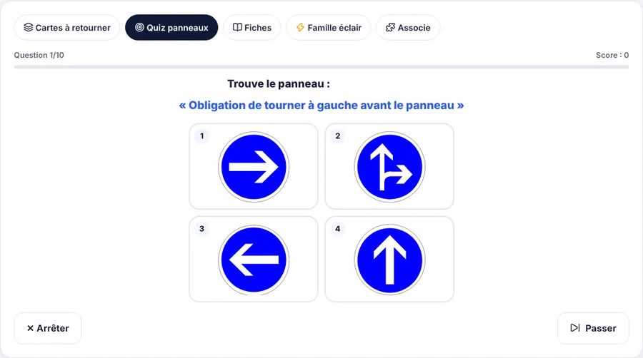

<p align="center"></p>

<h1 align="center">Code Facile</h1>
<p align="center"><b>Le Code de la route, enfin simple.</b><br>Des leçons courtes avec de vrais panneaux, des quiz comme le jour de l'examen, et ta progression qui te suit partout.</p>

<p align="center">
<a href="https://code-facile-60658.web.app/"><b>🌐 Utiliser Code Facile en ligne</b></a>
&nbsp;·&nbsp;
<a href="#-télécharger-lapplication"><b>⬇️ Télécharger l'application</b></a>
</p>

<p align="center"></p>

## ✨ Ce que tu trouves dans Code Facile

| | |
|---|---|
| 📚 **122 leçons courtes** | Les 10 thèmes de l'examen, expliqués simplement avec de vrais panneaux et des schémas. |
| 🎯 **Près de 800 questions** | Quiz par thème, examens blancs de 40 questions, mode survie, révision de tes erreurs. |
| 🚸 **218 panneaux officiels** | Avec un filtre **« Panneaux essentiels »** pour réviser d'abord ceux que tu vois le plus sur la route. |
| 🏆 **89 badges** | Bronze, argent, or, diamant, et des badges secrets à découvrir. Épingle tes 3 préférés sur ton profil. |
| 🚗 **La partie permis** | Vérifications du véhicule, les 100 questions de l'oral, premiers secours, angles morts, stationnement. |
| ☁️ **Compte gratuit** | Ta progression est sauvegardée en ligne : commence sur ton ordinateur, continue sur ton téléphone. |

<p align="center">

&nbsp;

</p>
<p align="center"></p>

## ⬇️ Télécharger l'application

| Appareil | Téléchargement | Taille |
|---|---|---|
| 🖥️ **Windows** 10 et 11 | [**Code-Facile-Windows.exe**](https://github.com/JinxyNova/ode-facile/raw/main/download/Code-Facile-Windows.exe) | 5,4 Mo |
| 🍎 **Mac** (puces Apple et Intel) | [**Code-Facile-Mac.zip**](https://github.com/JinxyNova/ode-facile/raw/main/download/Code-Facile-Mac.zip) | 3,2 Mo |
| 🤖 **Android** 7 et plus | [**Code-Facile-Android.apk**](https://github.com/JinxyNova/ode-facile/raw/main/download/Code-Facile-Android.apk) | 1,2 Mo |
| 📱 **iPhone et iPad** | [Ouvrir le site dans Safari](https://code-facile-60658.web.app/), puis Partager → « Sur l'écran d'accueil » | – |

L'application est **gratuite**, sans publicité, et se met à jour avec le site.

### Comment l'installer

<details><summary><b>🖥️ Windows</b></summary>

1. Ouvre le fichier **Code-Facile-Windows.exe** téléchargé.
2. Si Windows affiche « Windows a protégé votre ordinateur », clique sur **Informations complémentaires** puis **Exécuter quand même**. C'est normal pour une appli gratuite qui n'est pas vendue sur un store.
3. Garde le fichier au même endroit (et avec le même nom) pour retrouver ta progression, ou crée un compte gratuit dans l'appli.
</details>

<details><summary><b>🍎 Mac</b></summary>

1. Ouvre le fichier **.zip** : l'app **Code Facile** apparaît.
2. Glisse-la dans ton dossier **Applications**.
3. La première fois : clic droit sur l'app puis **Ouvrir**. Si le Mac bloque, va dans **Réglages Système → Confidentialité et sécurité** puis **Ouvrir quand même**.
</details>

<details><summary><b>🤖 Android</b></summary>

1. Ouvre le fichier **Code-Facile-Android.apk** téléchargé.
2. Si ton téléphone le demande, autorise l'installation d'applis depuis ton navigateur.
3. Appuie sur **Installer**, puis ouvre Code Facile.
</details>

<details><summary><b>📱 iPhone et iPad</b></summary>

1. Ouvre [le site Code Facile](https://code-facile-60658.web.app/) dans **Safari**.
2. Appuie sur le bouton **Partager** (le carré avec une flèche).
3. Choisis **« Sur l'écran d'accueil »** : l'icône Code Facile apparaît comme une vraie appli.
</details>

### 🔒 Vérifier les fichiers

Pour vérifier qu'un fichier n'a pas été modifié, compare son empreinte SHA-256 avec la [liste officielle](download/SHA256SUMS.txt) :

```
d32c629cb97eaeefc940e526bc923d52a6f7b2b829019b3ceca045fe641a7811  Code-Facile-Windows.exe
b1f9198560ec16026575d7e8710ce2f1bca645f84708bb6ce243c9072a97f1af  Code-Facile-Mac.zip
86831dd11900eb266aa36b04af394ae4f296d02b0470f1984a90a3280ae39cd3  Code-Facile-Android.apk
```

---

<p align="center"><a href="https://code-facile-60658.web.app/"><b>👉 Aller sur le site Code Facile</b></a></p>
